<p align="center">
  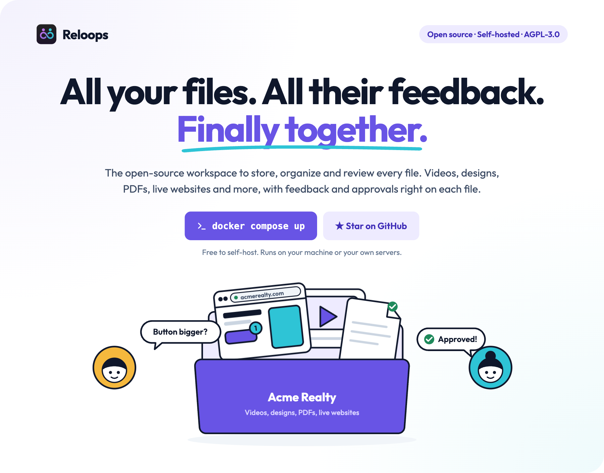
</p>

<p align="center">
  <a href="https://opensource.org/license/agpl-v3"></a>
  <a href="https://github.com/Reloops-App/reloops/stargazers"></a>
  <a href="https://github.com/Reloops-App/reloops/graphs/traffic"></a>
  <a href="https://discord.gg/sas5PUPqN"></a>
</p>

<p align="center">
  <a href="#-quick-start"><strong>Quick start</strong></a>
  ·
  <a href="#-see-reloops-in-action"><strong>See it in action</strong></a>
  ·
  <a href="#-self-hosted-or-hosted"><strong>Self-host vs hosted</strong></a>
  ·
  <a href="https://discord.gg/sas5PUPqN"><strong>Discord</strong></a>
  ·
  <a href="https://reloops.app"><strong>reloops.app</strong></a>
</p>

## 🚀 Quick Start

<p align="center">
  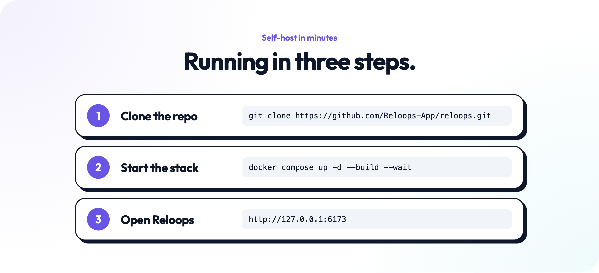
</p>

```bash
git clone https://github.com/Reloops-App/reloops.git
cd reloops
docker compose up -d --build --wait --wait-timeout 600
```

Then open **http://127.0.0.1:6173**. For manual pnpm setup, environment variables, and ports, see the [Local Setup Guide](docs/SETUP.md).

## 🗂️ Every File Type

<p align="center">
  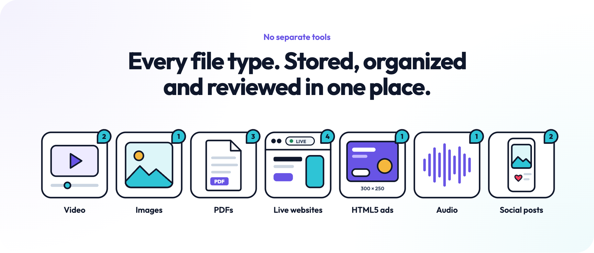
</p>

<p align="center">
  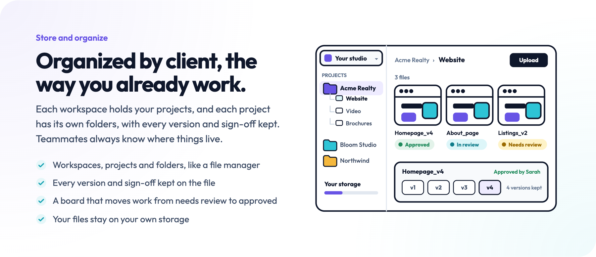
</p>

## 🎬 See Reloops in Action

### Click anywhere on a design to leave a note

<p align="center">
  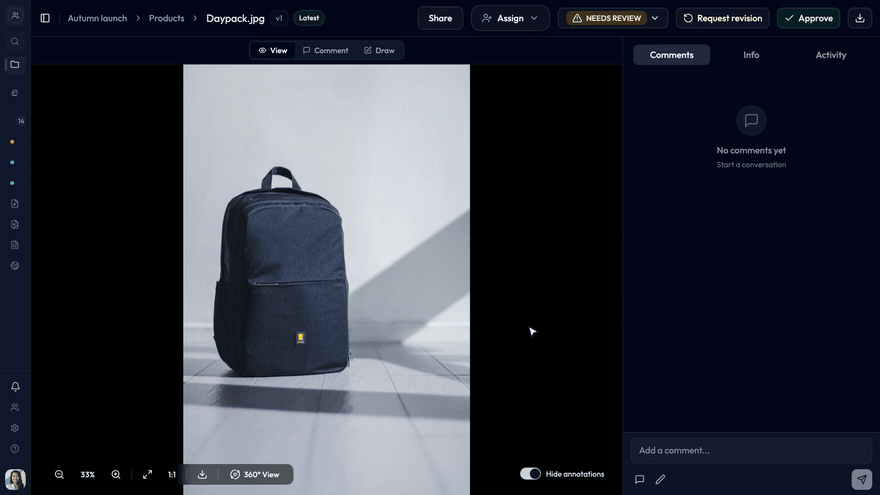
</p>

### Comments land on the exact frame

<p align="center">
  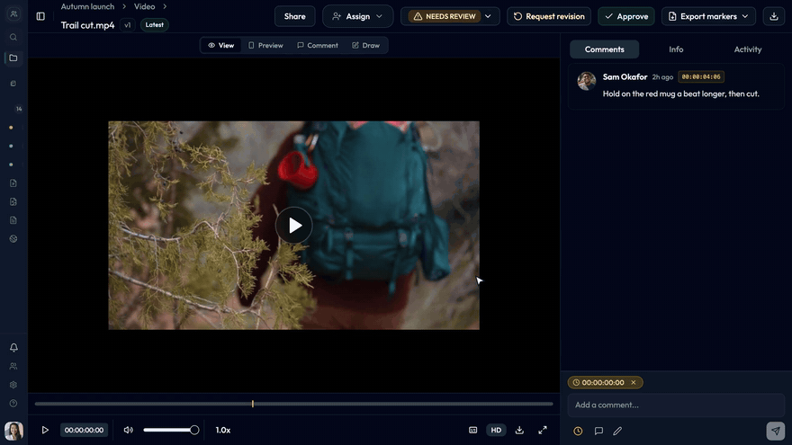
</p>

<table>
  <tr>
    <td width="50%">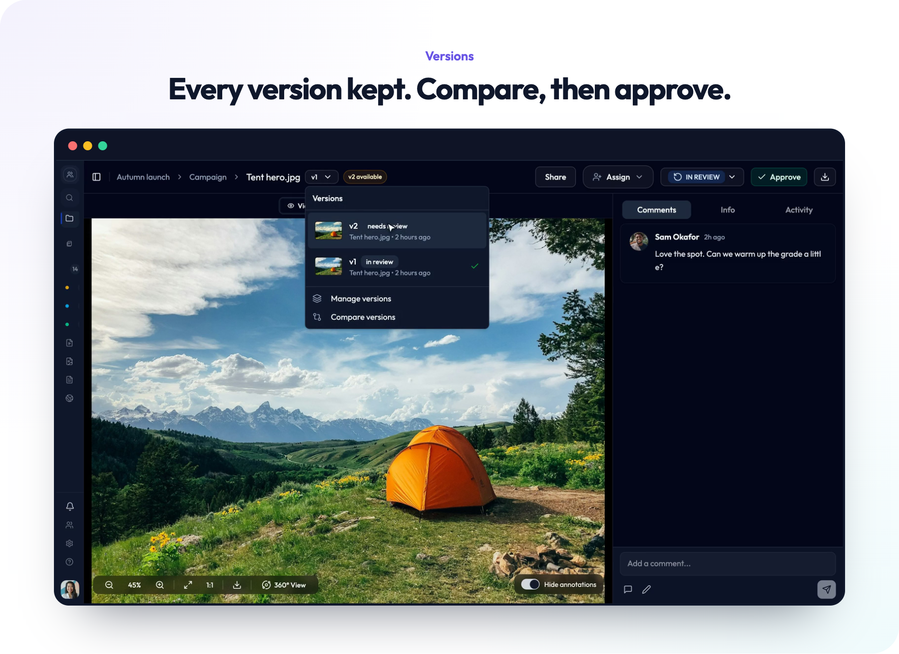</td>
    <td width="50%">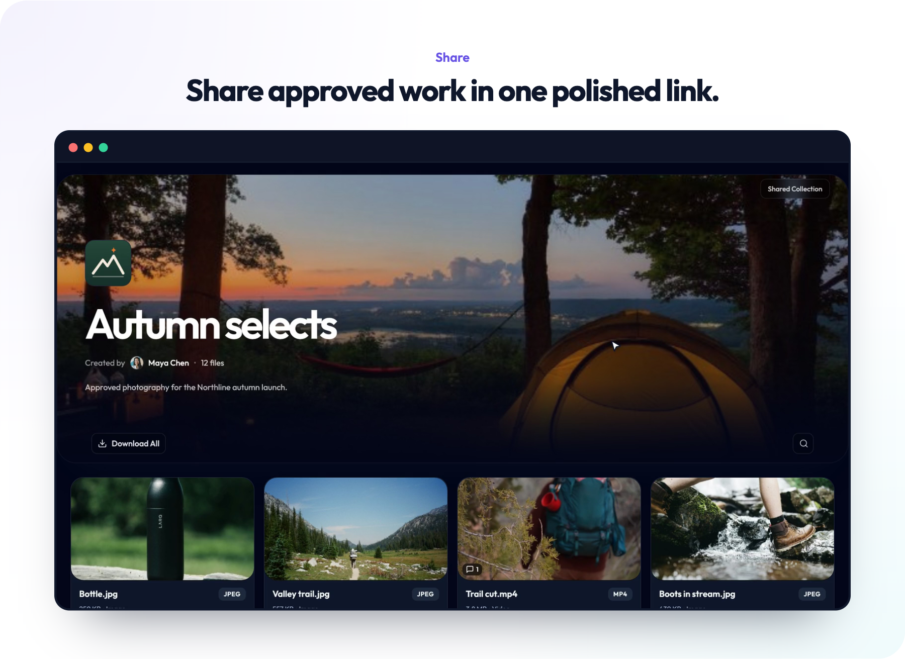</td>
  </tr>
</table>

## 🔎 Find Anything

<p align="center">
  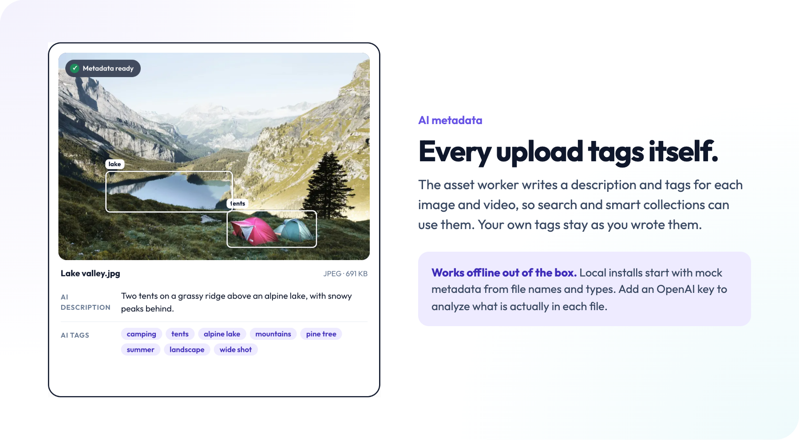
</p>

<p align="center">
  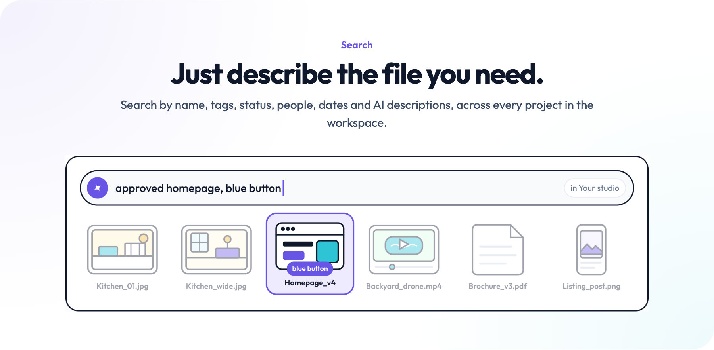
</p>

> [!NOTE]
> Local installs start with `ASSET_AI_PROVIDER=mock`, which builds metadata from file names, types, existing tags, dimensions, and project. It does not look inside your files or call an AI service. Enable the optional OpenAI provider to analyze images and sampled video frames; see [Local Setup](docs/SETUP.md#optional-openai-metadata).

## 🤖 Built for Teams and Agents

<p align="center">
  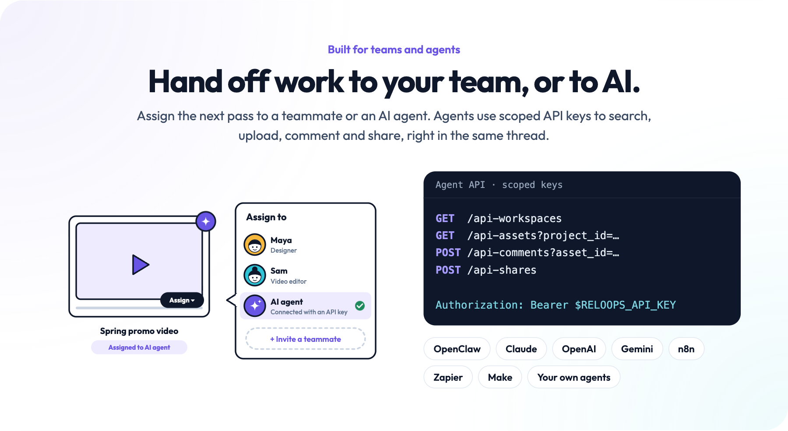
</p>

- 🔑 Create scoped API keys for OpenClaw, OpenAI, Claude, Gemini, Zapier, n8n, Make, and your own agents.
- 🗂️ Agents can list and create workspaces and projects, fetch and upload assets, patch status, comment, and manage share links.
- 🧩 OpenClaw can use the included [`openclaw-reloops-api`](skills/openclaw-reloops-api/SKILL.md) skill; see the [OpenClaw API Skill guide](docs/openclaw-reloops-api.md).

## 🏠 Self-hosted or Hosted

<p align="center">
  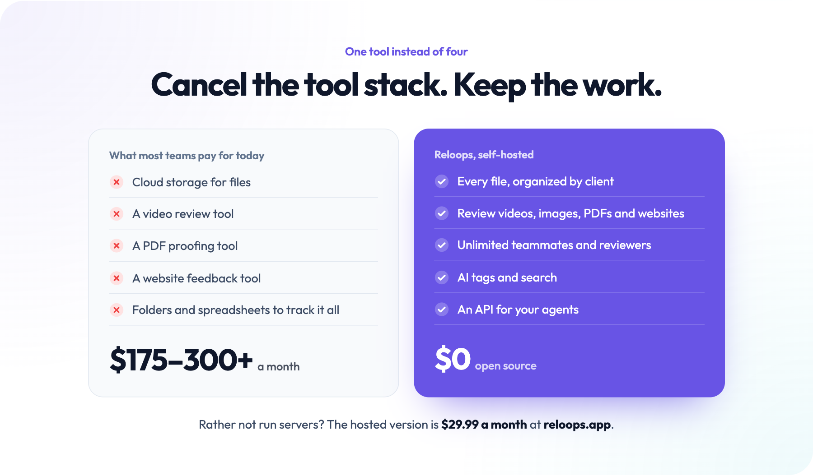
</p>

This repository is the open-source, self-hosted version of Reloops. Prefer not to run servers? Use the hosted version at **[reloops.app](https://reloops.app)**.

| | Self-hosted (this repo) | Hosted ([reloops.app](https://reloops.app)) |
|---|:---:|:---:|
| Workspaces, projects, folders, versions, comments, approvals | ✅ | ✅ |
| Video, image, PDF, website, audio, and HTML5 review | ✅ | ✅ |
| Share links, collections, and guest comments | ✅ | ✅ |
| Search and smart metadata | ✅ mock, or your OpenAI key | ✅ |
| API keys for agents | ✅ | ✅ |
| Managed cloud storage and workers | Bring your own | ✅ |
| Website screenshot capture | With your `SCREENSHOTONE_ACCESS_KEY` | ✅ |
| Email delivery | Wire up your own | ✅ |

<details>
<summary><strong>What exactly is included in the OSS package</strong></summary>

<br />

* ✅ Included:
  - Supabase Auth, Postgres, Storage, and Edge Functions
  - Workspaces, teams, projects, folders, assets, versions, comments, reviews, assignments, and notifications
  - Creative asset search, collections, metadata filtering, smart descriptions and tags (mock by default, optional OpenAI analysis), share links, project sharing, and guest comments
  - API-key agent endpoints for controlled automation inside workspaces
  - Local asset intelligence worker with DB queue polling
  - Local-first setup for running the full product on your machine or own infrastructure

* ⚠️ Not included:
  - Hosted billing and managed subscription infrastructure
  - Hosted cloud storage integrations beyond local Supabase Storage defaults
  - Hosted workers, QStash, Cloudflare Workers, and commercial deployment infrastructure
  - Managed analytics and hosted screenshot-capture credits
  - Managed email delivery; local OSS includes notification data/preferences and local invite handling, but production email delivery is expected to be wired by the self-hosting team

* 🗄️ Storage and capture:
  - Uploads use Supabase Storage.
  - Website review works with uploaded screenshots, or captured screenshots when `SCREENSHOTONE_ACCESS_KEY` is configured.
  - Asset intelligence runs locally through the worker unless you connect your own production worker setup.

</details>

<details>
<summary><strong>Alternative to Frame.io, Brandfolder, Google Drive, Filestage, and more</strong></summary>

<br />

| If you are using... | Reloops helps you replace or extend it with... |
|---------------------|-----------------------------------------------|
| Google Drive, Dropbox, Notion, Airtable | Purpose-built file workspaces instead of folders, rows, and scattered comments |
| Brandfolder, Bynder, Canto | Self-hosted asset management, collections, metadata, search, and asset history |
| Frame.io, Dropbox Replay, Wipster | Review, comments, version stacks, approvals, and share links alongside the file library |
| Ziflow, Filestage, ReviewStudio | Structured feedback without a heavyweight enterprise approval suite |
| Zapier, n8n, Make, custom agents | Controlled API actors that can participate directly in asset operations |
| Internal DAM tools | Auth, storage, asset views, review UI, share links, API keys, and local workers already wired together |

</details>

## 🧱 Tech Stack

- 📦 pnpm workspaces
- ⚛️ Vite + React + TypeScript
- 🟢 Supabase Auth, Postgres, Storage, RLS, and Edge Functions
- 🤖 Node asset intelligence worker
- 🔑 API-key agent layer
- 🐳 Docker for the full local stack

## 🤝 Contributing

Contributions are welcome. Start with [CONTRIBUTING.md](CONTRIBUTING.md); `pnpm test` runs unit coverage, contracts, typechecks, and the production build, and [Testing](docs/TESTING.md) covers browser and backend integration checks. Report security issues as described in [SECURITY.md](SECURITY.md).

Questions or ideas? Join the [Discord](https://discord.gg/sas5PUPqN).

## 📄 License


This repository's source code is available under the [AGPL-3.0 license](LICENSE).
